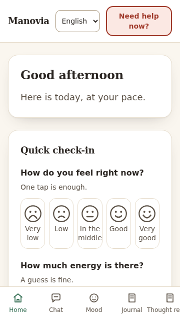
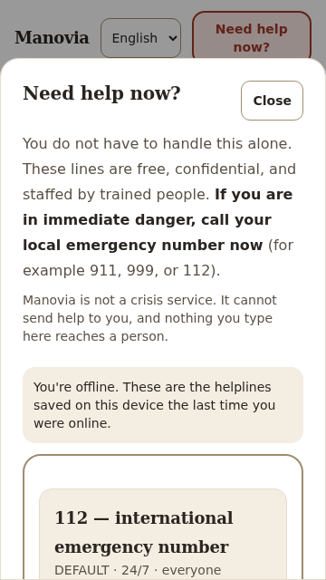
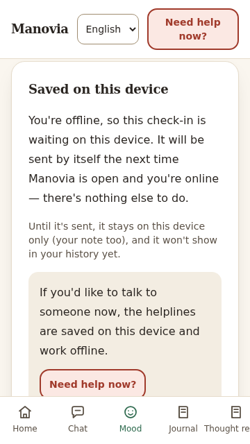
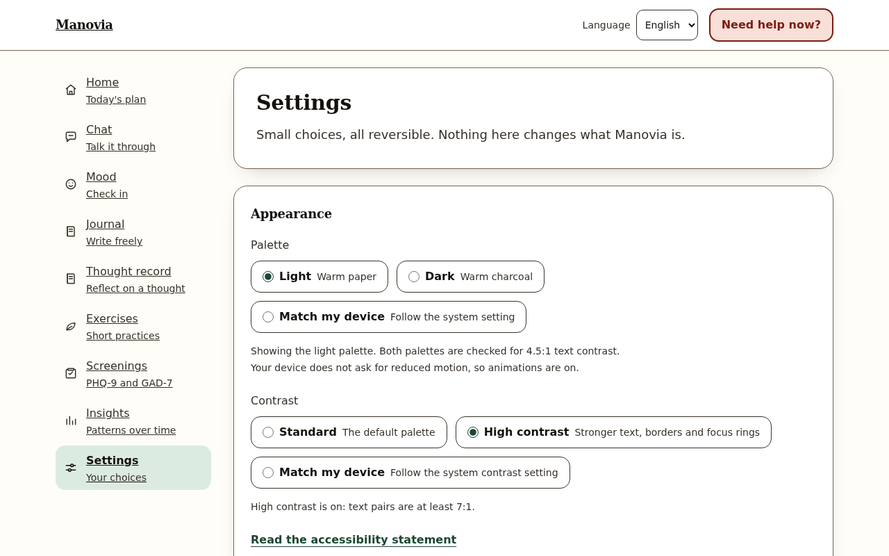
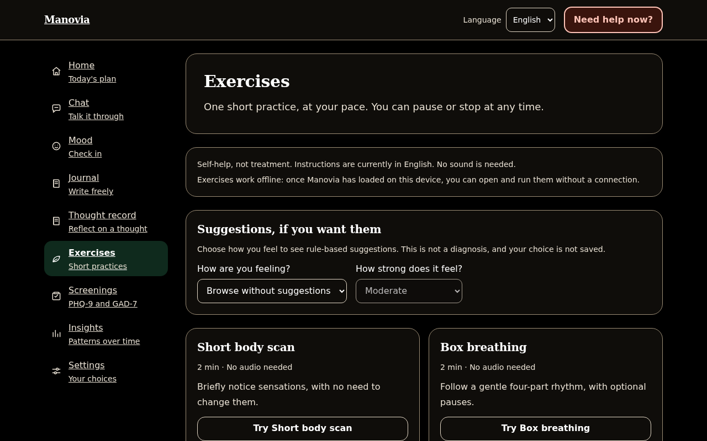
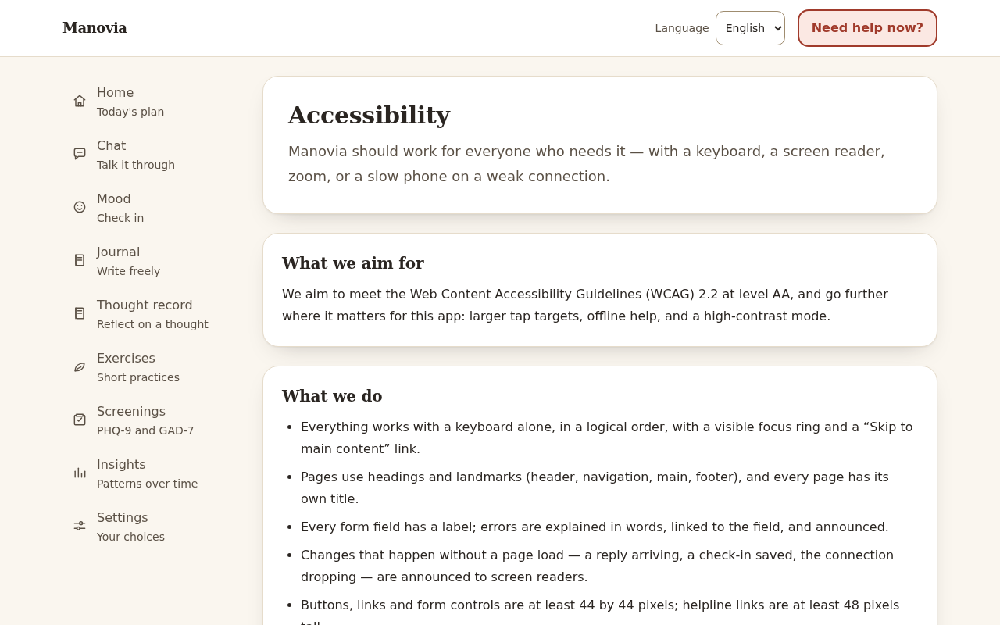

# Manovia

A privacy-first, safety-first self-help companion for mental wellbeing. It is not therapy, not a diagnosis, and not a crisis service.

> **If you are in danger or in crisis, call your local emergency number now.** The list below is a starting point, not a substitute. See [Crisis and emergency help](#crisis-and-emergency-help).

[](https://github.com/BuildbyArindam/Manovia/actions/workflows/ci.yml)


The coverage badge is a static figure from the Day 28 run (2026-10-13). It is updated by hand when the numbers change. The safety-module branch gate passes in that run. CI does not run that gate yet. See [Quality](#quality) and the [known issues](PROGRESS.md).

## What it is

Manovia is a chat-first companion with a set of self-help tools: mood check-ins, an encrypted journal, guided exercises, a CBT thought record, PHQ-9 and GAD-7 screenings, and a rule-based daily plan. It is in English, Hindi and Bengali. Message text, journal entries and mood notes are encrypted at rest, and the user can export or delete everything.

Safety comes first. Crisis rules run before any language model is called. A high-risk message gets a pre-written, localised reply and helpline details, and the model is never called for it. Every model reply passes a deterministic output check before it is stored or shown.

Manovia is a self-help companion. It has not been reviewed by a licensed clinician or launched to the public. The review checklist is in [docs/clinical-review.md](docs/clinical-review.md).

## Features

- **Supportive chat.** Deterministic crisis rules run before any model call. Everything else goes through PII redaction, curated retrieval, a provider chain (Anthropic, Ollama, or a canned local fallback), and a whole-reply output guard ([ADR 0011](docs/adr/0011-chat-orchestrator.md), [ADR 0014](docs/adr/0014-output-guard-and-conversation-memory.md)).
- **Safety detection.** A rules engine plus a one-way ML backstop. The ML model can raise a risk level but never lower it ([ADR 0008](docs/adr/0008-crisis-detection-rules-engine.md), [ADR 0009](docs/adr/0009-safety-ml-ensemble.md)).
- **Mood check-ins.** A five-point valence and energy form, tags, streaks and encrypted notes ([ADR 0015](docs/adr/0015-mood-check-ins.md)).
- **Encrypted journal.** AES-256-GCM envelope encryption with per-entry keys ([ADR 0017](docs/adr/0017-encrypted-journal-and-envelope-encryption.md)).
- **Guided exercises.** Eight exercises with a keyboard-operable runner and reduced-motion support ([ADR 0018](docs/adr/0018-guided-exercises.md)).
- **CBT thought record.** A seven-step, owner-only, encrypted wizard with per-step safety screening ([ADR 0019](docs/adr/0019-cbt-thought-record.md)).
- **PHQ-9 and GAD-7 screenings.** The published instrument wording and scoring. When PHQ-9 item 9 is positive, support options appear before any score ([ADR 0020](docs/adr/0020-phq-9-and-gad-7-screenings.md)).
- **Daily plan.** A transparent rule table that suggests at most three things a day, each with a "why this?" explanation. It respects quiet hours and drops to support-only after a positive item 9 ([ADR 0021](docs/adr/0021-daily-plan-and-week-3-review.md)).
- **Privacy controls.** Export everything, delete everything, and set retention ([ADR 0022](docs/adr/0022-privacy-controls-and-data-export.md)).
- **Offline and accessible.** An installable PWA where "Need help now" and the breathing exercises work without a connection, and check-ins made offline are sent when the device is back online. The app aims for WCAG 2.2 AA and includes an in-app accessibility statement ([ADR 0025](docs/adr/0025-pwa-accessibility-low-bandwidth.md)).

## Screenshots

Captured from the production build in Chromium, with a fresh guest account and synthetic content only (Day 25). To regenerate them, see [docs/assets/README.md](docs/assets/README.md).

| Home on a 360 × 640 phone | "Need help now?" with no connection | A check-in saved offline |
| --- | --- | --- |
|  |  |  |

| Settings in high contrast | Exercises in dark high contrast | The accessibility statement |
| --- | --- | --- |
|  |  |  |

The Day 12 chat screenshots (light, dark and the crisis card, at both sizes) are in [docs/assets](docs/assets/README.md).

## Quick start

### With Docker

Docker Desktop, or Docker Engine with the compose plugin, is the only prerequisite.

```bash
make up      # build and start the API, the web app and Postgres in the background
make smoke   # check readiness, a guest session, consent and the web app
# then open http://localhost:3000 (the API docs are at http://localhost:8000/docs)
```

The stack runs on development-only defaults without a `.env` file. Copy `.env.example` to `.env` to set your own values. `make down` stops the stack and keeps the database volume. `docker compose down -v` also wipes the database.

### Without Docker

Python 3.11+ and Node 20.19+:

```bash
# Backend: API on http://localhost:8000 (interactive docs at /docs)
cd backend
pip install -e ".[dev]"   # or: uv sync
alembic upgrade head      # create the schema
make dev

# Frontend: http://localhost:5173, with /api proxied to the backend
cd ../frontend
npm ci
npm run dev
```

| Command | What it does |
| --- | --- |
| `make up` | Build and start the Docker dev stack |
| `make down` | Stop the Docker dev stack (keeps the DB volume) |
| `make smoke` | Run `scripts/smoke.sh` against the stack |
| `make dev` | Backend API on :8000 |
| `make frontend-dev` | Frontend dev server on :5173 (proxies `/api`) |
| `make test` | Backend pytest with the coverage gate, plus frontend Vitest |
| `make lint` | Backend ruff and mypy, frontend ESLint |
| `make format` | Backend ruff format, frontend Prettier |
| `make db-upgrade` | `alembic upgrade head` |
| `make seed` | Create the demo user and its rows |
| `make eval` | Run the safety, emotion and response evaluations |

The frontend's own commands are in [frontend/README.md](frontend/README.md). They include `npm run budget` (bundle budgets), `npm run test:e2e:prod` (axe, keyboard, zoom, offline and installability in a real browser) and `npm run lighthouse` (mobile Lighthouse with budgets). CI runs the last two in `.github/workflows/a11y-lighthouse.yml`.

## Architecture

Manovia is a monorepo: a FastAPI backend, a React, Vite and TypeScript frontend, PostgreSQL for persistence (SQLite for local work), and provider-abstracted language-model integrations.

- [docs/architecture.md](docs/architecture.md): the chat pipeline, sequence diagrams for a chat turn and a crisis turn, and the offline model.
- [docs/api.md](docs/api.md): the HTTP reference, generated from the OpenAPI schema. A test fails if it drifts.
- [docs/adr/README.md](docs/adr/README.md): the index of architecture decision records.
- [docs/deploy.md](docs/deploy.md): the production deployment plan (Fly.io for the API and Postgres, Netlify for the web).

## Quality

- **Tests.** The backend suite (pytest) and the frontend suite (Vitest) run in CI. The Day 28 run is recorded in the [verification note](docs/verification/day28-documentation-and-portfolio.md).
- **Coverage.** Measured on 2026-10-13: statements 96.6%, branches 89.9%. The branch gate in `backend/scripts/coverage_gate.py` (run by `make test`) requires overall branch coverage of 85%, branch coverage of 95% for every `app/services/safety` module, and 100% for the crypto and scoring modules. In that run every safety module was at 100% branches, after two tests were added for the gaps that had failed the gate. CI runs pytest with an 80% statement floor and does not run the branch gate yet.
- **Evaluation.** [docs/evaluation-report.md](docs/evaluation-report.md) gives the full numbers, the methods and the limits. In brief, on the frozen test split (51 high-risk and imminent cases), the ensemble caught all 51 (exact 95% lower bound 0.930). Precision was 0.567. The test split has been scored at least once, so these figures are not a clean held-out result.

## Safety

Manovia is a self-help companion. It is not therapy, a diagnostic tool, or a crisis service. Crisis detection runs before any language-model call. High-risk messages get deterministic, pre-written support. Every model reply must pass an output-safety check. The non-negotiable rules are in [AGENTS.md](AGENTS.md). The design is in [docs/safety-design.md](docs/safety-design.md), and the model's intended use and limits are in [docs/model-card.md](docs/model-card.md).

## Crisis and emergency help

If you are in immediate danger, call your local emergency number now. In India that is **112**. In the US, Canada and some other countries it is **911**. In the UK it is **999**, and in Australia it is **000**.

Helplines by country are in [`backend/app/content/helplines.json`](backend/app/content/helplines.json), which the app uses. Some entries are flagged `needs_verification`, meaning they have not yet been confirmed against their official source. Check any number before relying on it. Examples in the file as of 2026-10-09:

- India: 112 (emergency), 14416 (Tele-MANAS).
- US: 988 (Suicide & Crisis Lifeline), with text lines.
- UK: 116 123 (Samaritans).
- Australia: 13 11 14 (Lifeline).

Manovia cannot send help to you. If you use the app offline, "Need help now" shows the helplines saved on the device the last time it was online.

## Privacy

Configuration comes only from environment variables (see `.env.example`), and secrets are never committed. Message text, journal entries and mood notes are encrypted at rest with Fernet, per field. The structured logger drops raw user text (`message_text`, `content`, `body`, `note`, credentials) before anything is written. An end-to-end test checks this. The user ID is never put in an LLM prompt, and a test checks that identifying text does not reach a provider. For the full threat model, see [docs/privacy-and-threat-model.md](docs/privacy-and-threat-model.md).

The production compose file refuses to start without `SECRET_KEY` and `FIELD_ENCRYPTION_KEY`.

## Documentation

- [docs/model-card.md](docs/model-card.md): every model in the product, its intended and out-of-scope use, metrics, failure modes and update policy.
- [docs/clinical-review.md](docs/clinical-review.md): the checklist a licensed professional should complete before public launch. It has no sign-offs yet.
- [docs/ethics-and-limitations.md](docs/ethics-and-limitations.md): the open questions and stated limits.
- [docs/demo-script.md](docs/demo-script.md): a 90-second walkthrough. It has not been recorded.
- [CONTRIBUTING.md](CONTRIBUTING.md), [CODE_OF_CONDUCT.md](CODE_OF_CONDUCT.md), [SECURITY.md](SECURITY.md) and [CHANGELOG.md](CHANGELOG.md).

## Known limitations and open decisions

- **Not clinically reviewed.** The crisis copy, helplines, knowledge base and screening presentation need review by a licensed clinician and by native speakers of Hindi and Bengali. See [docs/clinical-review.md](docs/clinical-review.md) and [translations/STATUS.md](translations/STATUS.md).
- **CI does not run the branch gate.** The gate passes locally under `make test`. Adding it to the CI workflow is the next step.
- **Open decisions:** the copyright line in `LICENSE` is still a placeholder, private vulnerability reporting is disabled on GitHub, and the product has no age policy or age gate.
- **Model versions:** no model identifier is hard-coded, so the production model version is not recorded in the repository.

The complete list is in [PROGRESS.md](PROGRESS.md).

## Roadmap

- **Weeks 1 to 3 (Days 1 to 21):** scaffolding, backend and frontend skeletons, the data layer, auth with consent, the crisis rules engine and safety ML backstop, the LLM provider layer, the chat orchestrator and UI, the knowledge base and retrieval, the output guard, check-ins, the journal, exercises, the CBT thought record, screenings and the daily plan.
- **Week 4 (Days 22 to 28):** privacy controls, English, Hindi and Bengali, the evaluation harness, offline and accessibility work, deployment and observability, and documentation.
- **Next:** clinician and native-speaker review of the crisis content and safe replies; retraining the safety classifier on the current scikit-learn release with hard negatives; running the branch gate in CI; a first real deployment; and a shared session store so that more than one worker can run. The full list is in the parking lot in [PROGRESS.md](PROGRESS.md).
