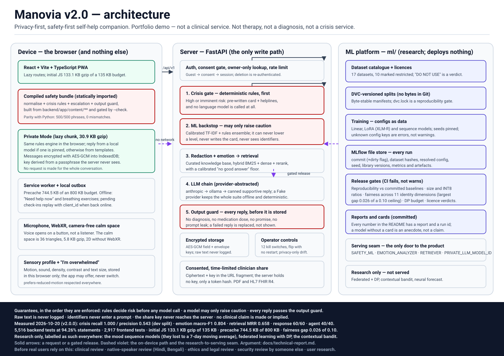
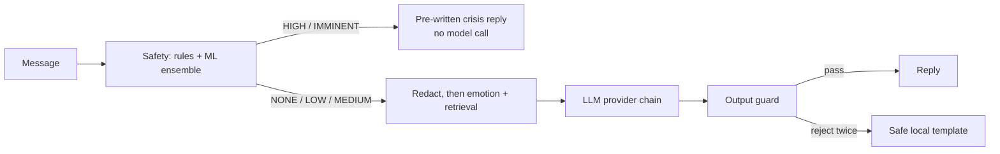

# Manovia

**v2.0.0 — portfolio demo, not a clinical service.** Manovia is a portfolio project. It has not completed the [clinical review](docs/clinical-review.md), and any live demo is labelled *"Portfolio demo — not a clinical service"* in the app footer (`frontend/src/components/AppShell.tsx`, all three locales). Do not rely on it for care.

A privacy-first, safety-first self-help companion for mental wellbeing. It is not therapy, not a diagnosis, and not a crisis service.

> **If you are in danger or in crisis, call your local emergency number now.** The list below is a starting point, not a substitute. See [Crisis and emergency help](#crisis-and-emergency-help).

[](https://github.com/BuildbyArindam/Manovia/actions/workflows/ci.yml)


The badge is a static figure from the **v2.0.0 verification run on 2026-10-20** (5,524 backend tests passed, 2 skipped; 2,917 frontend tests passed, 3 skipped), and it is updated by hand when the numbers change. The gate in `backend/scripts/coverage_gate.py` requires 85 % overall and 95 % for every `app/services/safety` module — **all rules satisfied** in that run, including the two safety modules that were red on Day 35. See [Quality](#quality) and [docs/verification/day49-verification.md](docs/verification/day49-verification.md).

## What it is

Manovia is a chat-first companion with a set of self-help tools: mood check-ins, an encrypted journal, guided exercises, a CBT thought record, PHQ-9 and GAD-7 screenings, and a rule-based daily plan. It is in English, Hindi and Bengali. Message text, journal entries and mood notes are encrypted at rest, and the user can export or delete everything.

Safety comes first. Crisis rules run before any language model is called. A high-risk message gets a pre-written, localised reply and helpline details, and the model is never called for it. Every model reply passes a deterministic output check before it is stored or shown.

Manovia is a self-help companion. It has not been reviewed by a licensed clinician or launched to the public. The review checklist is in [docs/clinical-review.md](docs/clinical-review.md).

## Features

- **Supportive chat.** Deterministic crisis rules run before any model call. Everything else goes through PII redaction, curated retrieval, a provider chain (Anthropic, Ollama, or a canned local fallback), and a whole-reply output guard ([ADR 0011](docs/adr/0011-chat-orchestrator.md), [ADR 0014](docs/adr/0014-output-guard-and-conversation-memory.md)).
- **Retrieval you can measure.** `RETRIEVER=baseline|hybrid|hybrid_rerank` selects the Day-13 dense retriever, BM25 + dense with reciprocal-rank fusion, or that plus a cross-encoder over the top 20 candidates. Each hybrid setting carries a **calibrated "no good answer" floor** fitted on its own calibration split, so a turn can legitimately show no card. Scored on a frozen 52-query test split from a 254-query labelled eval set: Recall@1 0.292 → 0.354 and MRR 0.639 → 0.658 for +5.4 ms p95 ([ADR 0035](docs/adr/0035-fine-tuned-retrieval.md), [the numbers and the ten failure cases](docs/verification/day35-retrieval.md)).
- **Safety detection.** A rules engine plus a one-way ML backstop. The ML model can raise a risk level but never lower it ([ADR 0008](docs/adr/0008-crisis-detection-rules-engine.md), [ADR 0009](docs/adr/0009-safety-ml-ensemble.md)).
- **Mood check-ins and optional Outlook.** A five-point valence and energy form, tags, streaks and encrypted notes ([ADR 0015](docs/adr/0015-mood-check-ins.md)). Mood Outlook is off by default and requires an explicit opt-in; it uses recent numeric check-ins only (never notes), withholds estimates below 14 distinct days in the last 28 or when the latest check-in is over seven days old, and shows a rough three-day range. The range is a descriptive variability estimate, **not a calibrated confidence interval, probability or medical advice**. No sequence-model result is served or claimed ([ADR 0036](docs/adr/0036-mood-forecasting.md), [verification](docs/verification/day36-mood-forecasting.md)).
- **Encrypted journal.** AES-256-GCM envelope encryption with per-entry keys ([ADR 0017](docs/adr/0017-encrypted-journal-and-envelope-encryption.md)).
- **Guided exercises.** Eight exercises with a keyboard-operable runner and reduced-motion support ([ADR 0018](docs/adr/0018-guided-exercises.md)).
- **CBT thought record.** A seven-step, owner-only, encrypted wizard with per-step safety screening ([ADR 0019](docs/adr/0019-cbt-thought-record.md)).
- **PHQ-9 and GAD-7 screenings.** The published instrument wording and scoring. When PHQ-9 item 9 is positive, support options appear before any score ([ADR 0020](docs/adr/0020-phq-9-and-gad-7-screenings.md)).
- **Daily plan.** A transparent rule table that suggests at most three things a day, each with a "why this?" explanation. It respects quiet hours and drops to support-only after a positive item 9 ([ADR 0021](docs/adr/0021-daily-plan-and-week-3-review.md)).
- **Privacy controls.** Export everything, delete everything, and set retention ([ADR 0022](docs/adr/0022-privacy-controls-and-data-export.md)).
- **Offline and accessible.** An installable PWA where "Need help now" and the breathing exercises work without a connection, and check-ins made offline are sent when the device is back online. The app aims for WCAG 2.2 AA and includes an in-app accessibility statement ([ADR 0025](docs/adr/0025-pwa-accessibility-low-bandwidth.md)).
- **A calm space, in VR or without it.** `/calm` is a seated, still, low-poly evening lake with an orb that follows a six-breaths-a-minute cue, optional procedural audio, and WebXR where the browser and a headset support it. There is no artificial locomotion, the horizon never moves, nothing flashes, any controller button ends the session, a break prompt appears after ten minutes, and the page states who VR is not recommended for. With no WebXR the same scene runs as a 2D canvas, which is the path most people get. The renderer is 36 triangles and a few hundred lines, with no 3D library and no assets ([ADR 0046](docs/adr/0046-xr-calm-space-and-sensory-profile.md), [verification](docs/verification/day46-xr-sensory.md)).
- **A sensory profile, applied everywhere.** Settings → Sensory profile sets motion (none/low/normal), sound (off/low), density (simple/standard), colours (calm/high-contrast) and text size, stored in this browser only. One tap on "I'm overwhelmed" hides charts, badges and secondary copy across the app and leaves breathing, grounding, chat and help. If several recent check-ins were activated and unpleasant, the app may *offer* the simpler view — never switch it on by itself ([ADR 0046](docs/adr/0046-xr-calm-space-and-sensory-profile.md)).
- **A summary you can take to an appointment.** `/shares` builds a document from exactly the items you tick — mood trend, screening totals and bands, chosen thought records, exercise helpfulness, a note, questions to ask — shows you the consent lines and a live preview of the document itself, and then creates a link that expires (7 days by default), allows a limited number of views, needs a passcode, can be revoked one at a time or all at once, and is stored as AES-256-GCM ciphertext whose key travels in the URL fragment and is never held by the server. The recipient opens `/s/<token>` with no account and decrypts in their own browser. Exports are a printable PDF and an **HL7 FHIR R4** document bundle whose assessment totals carry verified LOINC codes (PHQ-9 `44261-6`, GAD-7 `70274-6`) and whose Provenance names the patient as author and the app as assembler. Every document says **patient-generated, not a diagnosis**, and this is **not** an EHR integration and **not** for emergencies ([ADR 0047](docs/adr/0047-clinician-share-bridge.md), [docs/clinical-sharing.md](docs/clinical-sharing.md), [verification](docs/verification/day47-clinician-share-bridge.md)).

## AI and ML

Every number in this table was produced by a command in this repository on a
recorded date, and links to the committed report that quotes it. Numbers that
could not be measured in the build sandbox say so instead of being estimated.
The full argument, with the method and the failure cases behind each row, is in
[docs/technical-report.md](docs/technical-report.md); the ML platform itself is
in [ml/](ml/README.md).

| # | What | Result | How it was measured | Artefact |
| --- | --- | --- | --- | --- |
| 1 | **Crisis recall** (dev split, 116 cases, 51 high/imminent) | **1.000** [1.000, 1.000]; rules-only 0.333 | `make eval` (rules + calibrated TF-IDF backstop) | [evals/reports/2026-10-20/safety.md](evals/reports/2026-10-20/safety.md) |
| 2 | **Crisis precision** (same split) | **0.543** [0.441, 0.645] — 31/51 benign cases escalated | `make eval` | same report, §“false-alarm cost” |
| 3 | **Emotion macro-F1** (162 cases, en/hi/bn) | **0.804** [0.739, 0.853]; in-domain 0.992, domain-shift 0.011 | `make eval` | [evals/reports/2026-10-20/emotion.md](evals/reports/2026-10-20/emotion.md) |
| 4 | **Response pipeline** (60 scripted scenarios, 6 checks) | **60/60** (1.000) with `FakeLLMProvider` | `make eval` | [evals/reports/2026-10-20/response.md](evals/reports/2026-10-20/response.md) |
| 5 | **Retrieval** (frozen test split, 52 queries) | `hybrid_rerank` MRR **0.658**, Recall@1 **0.354**, p95 **8.5 ms** vs baseline 0.639 / 0.292 / 3.0 ms | `make ml-retrieval-eval` (Day-35 pipeline) | [ml/reports/day35-retrieval.md](ml/reports/day35-retrieval.md) |
| 6 | **Mood forecast** (72 synthetic users, held-out 15) | best baseline `moving_average_7d` MAE **0.554**, MASE **0.915**, coverage **78.3 %** of nominal 80 %; best neural (`transformer`) MAE **0.561** — **the neural model did not win** | `make ml-mood-forecast` (MLflow run `37eebe3842f3493cb252f4b0740c6711`) | [ml/reports/day36-mood-forecasting.md](ml/reports/day36-mood-forecasting.md) |
| 7 | **Intervention policy** (synthetic bandit, 20 seeds) | LinUCB cumulative reward **193.795** [186.693, 200.897] vs random −73.388; exploration capped at 20 %, never consecutive | `make ml-jitai-sim` (run `e3aa0567709149068a55b5fb25defa40`) | [ml/reports/day37-jitai.md](ml/reports/day37-jitai.md) |
| 8 | **Federated learning + DP** (50 synthetic clients) | DP σ=3.2, C=1.0: **ε 0.8417** at δ 1e-5, MASE **1.2754** vs centralised **1.3372** | `make ml-federated-sim` (run `aba1806ad18e48a8959065639f04e14d`) | [ml/reports/day38-federated.md](ml/reports/day38-federated.md) |
| 9 | **Fairness gate** (5 models × 11 dimensions × 53 phrase variants) | **PASS**, largest gap **0.026** (region, ceiling 0.10); per-dimension 0.008–0.026 | `python ml/scripts/check_fairness_gates.py` | [ml/reports/fairness.json](ml/reports/fairness.json) |
| 10 | **Agent navigator** (40 scripted scenarios) | **40/40**, incl. 4 safety-gate, 4 injection, 3 confirmation-gating scenarios | `make eval-agent` | [evals/reports/2026-10-20/agent_eval.json](evals/reports/2026-10-20/agent_eval.json) |
| 11 | **Voice (fake stages, 25 turns)** | p95 **time-to-first-audio 98.614 ms** (budget 1500 ms), VAD p95 0.016 ms | `make voice-sim` | [docs/verification/day40-realtime-voice.md](docs/verification/day40-realtime-voice.md) |
| 12 | **Private Mode parity** (Python vs TypeScript safety engine) | **500/500** phrases identical risk level, 0 mismatches | `make parity` | [docs/verification/day41-browser-private-ai.md](docs/verification/day41-browser-private-ai.md) |
| 13 | **Calm space / WebXR** | **5.8 KB** gzip route increment, 36 triangles, frame p95 **0.012–0.013 ms** CPU draw | `npm run budget`, `measure:frames` | [docs/verification/day46-xr-sensory.md](docs/verification/day46-xr-sensory.md) |
| 14 | **Distillation gates** | student/teacher size **0.073** (max 0.5), INT8/fp32 **0.292** (max 1.1) | `make ml-distill-smoke` | [ml/reports/day34-safety-compression.md](ml/reports/day34-safety-compression.md) |
| 15 | **Backend tests + coverage** | **5,524 passed, 2 skipped**; statements **94.28 %**, branches **85.50 %**; safety gate green | `make test` | [docs/verification/day49-verification.md](docs/verification/day49-verification.md) |
| 16 | **Frontend tests + budget** | **2,917 passed, 3 skipped**; initial JS **133.1 KB** gzip of 135 KB, precache **744.5 KB** of 800 KB | `npm run test:run`, `npm run budget` | [docs/performance.md](docs/performance.md) |
| 17 | **Red team** | **150/150** scripted attacks (Day 29); 12 new findings with regression tests (Day 48) | `make test` (`tests/redteam`) | [docs/redteam-report.md](docs/redteam-report.md), [docs/verification/day48-redteam.md](docs/verification/day48-redteam.md) |
| 18 | **Full user journey** | **13/13** steps (onboarding → crisis → mood → outlook → exercise → journal → agent → share → export → delete) | `python3 scripts/verify_day49_journey.py` | [docs/verification/day49-verification.md](docs/verification/day49-verification.md) |

**How to read this table.** Rows 1–4 and 17 are product-path measurements on
synthetic hand-written data. Rows 5–14 are *research* experiments: the panels are
synthetic, no weights are served, and none of them is a clinical claim. Row 6 is
the most honest line in the repository — a sequence model was built, trained and
measured, and it lost to a seven-day moving average; the product therefore keeps
serving the deterministic baseline and says so in the UI. Rows 11 and 13 have no
GPU, headset or microphone behind them: they measure the code path with a fake
audio stage and a 2D canvas.

Reproduce any row with the command in it; `make ml-eval RUN=<id>` re-scores a
logged MLflow run, and each MLflow run records the git commit, dataset hashes,
resolved config, seed and library versions (ML ground rule 5).

## What we chose not to build, and why

A release is also a list of refusals. These were deliberate:

- **A neural mood forecast in the product.** The measured neural models did not
  beat a seven-day moving average on held-out synthetic users (row 6). Shipping
  the more impressive thing would have been shipping the worse thing, so Outlook
  is a deterministic, opt-in, numeric-only descriptive range
  ([ADR 0036](docs/adr/0036-mood-forecasting.md)).
- **Federated learning in production.** The simulation runs, the DP budget is
  measured (ε 0.8417 at δ 1e-5), and the conclusion is that operating it safely
  needs clients we do not have and a privacy review we have not had
  ([ADR 0038](docs/adr/0038-privacy-preserving-ml.md)). It stays research.
- **A bandit choosing what a person sees on their first day.** The simulator
  needs ~60 decisions per user to look good; a wellbeing app that learns on
  someone's worst week is not a trade this project will make. Exploration is
  capped, never consecutive, and off in the product
  ([ADR 0037](docs/adr/0037-personalised-intervention-policy.md)).
- **An LLM as the safety decision.** Rules decide risk, deterministically, before
  any model call; a model may only raise caution
  ([ADR 0008](docs/adr/0008-crisis-detection-rules-engine.md),
  [ADR 0009](docs/adr/0009-safety-ml-ensemble.md)). The LLM judge that exists is
  advisory and never a CI gate.
- **On-device model weights in Git.** No `.safetensors`, no `.onnx`, no corpora
  (AGENTS.md ML ground rule 3). Private Mode therefore ships *unpinned* and
  answers with templates until an operator runs `npm run models:pin` somewhere
  with egress.
- **A clinician dashboard, appointments, prescriptions, or anything that looks
  like an EHR.** The share bridge produces a document the person owns and can
  revoke; there is no account for a clinician and no write path into a record
  ([ADR 0047](docs/adr/0047-clinician-share-bridge.md)).
- **Analytics, crash-SDK breadcrumbs and social features.** Zero third-party
  requests is a budget that CI enforces, and a timeline of someone's bad weeks is
  not a feed.
- **“Always listening” voice.** The microphone opens on a button, the stream is
  same-origin, and nothing is stored server-side
  ([ADR 0039](docs/adr/0039-realtime-voice-companion.md)).

## Screenshots

Captured from the production build in Chromium, with a fresh guest account and synthetic content only (Day 25). To regenerate them, see [docs/assets/README.md](docs/assets/README.md).

| Home on a 360 × 640 phone | "Need help now?" with no connection | A check-in saved offline |
| --- | --- | --- |
|  |  |  |

| Settings in high contrast | Exercises in dark high contrast | The accessibility statement |
| --- | --- | --- |
|  |  |  |

| The calm space (2D fallback) |
| --- |
|  |

The calm-space image is **not** a browser screenshot. No browser can run in the Day-46 build sandbox, so `frontend/scripts/render-calm-preview.mjs` executes the product's own `drawCalmFrame` painter against an SVG-writing context; the layout, palette and breath position come from the shipping code, and only the rasterisation is ours. Regenerate it with `node scripts/render-calm-preview.mjs` in `frontend/`.

The Day 12 chat screenshots (light, dark and the crisis card, at both sizes) are in [docs/assets](docs/assets/README.md).

## Quick start

### With Docker

Docker Desktop, or Docker Engine with the compose plugin, is the only prerequisite.

```bash
make up      # build and start the API, the web app and Postgres in the background
make smoke   # check readiness, a guest session, consent and the web app
# then open http://localhost:3000 (the API docs are at http://localhost:8000/docs)
```

The stack runs on development-only defaults without a `.env` file. Copy `.env.example` to `.env` to set your own values. `make down` stops the stack and keeps the database volume. `docker compose down -v` also wipes the database.

### Without Docker

Python 3.11+ and Node 20.19+:

```bash
# Backend: API on http://localhost:8000 (interactive docs at /docs)
cd backend
pip install -e ".[dev]"   # or: uv sync
alembic upgrade head      # create the schema
make dev

# Frontend: http://localhost:5173, with /api proxied to the backend
cd ../frontend
npm ci
npm run dev
```

| Command | What it does |
| --- | --- |
| `make up` | Build and start the Docker dev stack |
| `make down` | Stop the Docker dev stack (keeps the DB volume) |
| `make smoke` | Run `scripts/smoke.sh` against the stack |
| `make dev` | Backend API on :8000 |
| `make frontend-dev` | Frontend dev server on :5173 (proxies `/api`) |
| `make test` | Backend pytest with the coverage gate, plus frontend Vitest |
| `make lint` | Backend ruff and mypy, frontend ESLint |
| `make format` | Backend ruff format, frontend Prettier |
| `make db-upgrade` | `alembic upgrade head` |
| `make seed` | Create the demo user and its rows |
| `make eval` | Run the safety, emotion and response evaluations |

The frontend's own commands are in [frontend/README.md](frontend/README.md). They include `npm run budget` (bundle budgets), `npm run test:e2e:prod` (axe, keyboard, zoom, offline and installability in a real browser) and `npm run lighthouse` (mobile Lighthouse with budgets). CI runs the last two in `.github/workflows/a11y-lighthouse.yml`.

## Architecture

Manovia is a monorepo: a FastAPI backend, a React, Vite and TypeScript frontend, PostgreSQL for persistence (SQLite for local work), and provider-abstracted language-model integrations. Since v2.0 it also contains an **ML platform** (`ml/`: data catalogue, DVC-versioned splits, reproducible training, MLflow tracking, release gates, model and dataset cards) and an **on-device path** (Private Mode: the same safety rules compiled to JavaScript, plus optional in-browser models that never make a request).



The order of a chat turn is the safety property: the crisis gate runs before anything that can call a model, and nothing generated reaches a person before the output guard accepts it.



- [docs/technical-report.md](docs/technical-report.md): the paper-style account of the whole system — design, safety architecture, models, evaluation, privacy, limitations.
- [docs/architecture.md](docs/architecture.md): the chat pipeline, sequence diagrams for a chat turn and a crisis turn, the ML platform, the on-device path and the offline model.
- [docs/performance.md](docs/performance.md): bundle budgets, lazy-loading of the heavy modules, startup budgets and what is not measured.
- [docs/api.md](docs/api.md): the HTTP reference, generated from the OpenAPI schema. A test fails if it drifts.
- [docs/adr/README.md](docs/adr/README.md): the index of architecture decision records.
- [docs/deploy.md](docs/deploy.md): the production deployment plan (Fly.io for the API and Postgres, Netlify for the web).

## Quality

- **Tests.** `make test` runs the backend suite (pytest, with the coverage gate) and the frontend suite (Vitest). The v2.0.0 run on 2026-10-20 passed **5,524 backend tests (2 skipped)** and **2,917 frontend tests (3 skipped)**; `make lint` was clean on both sides (ruff, ruff format over 488 files, mypy over 418, ESLint, `tsc --noEmit`). Transcript: [docs/verification/day49-verification.md](docs/verification/day49-verification.md).
- **Coverage.** Measured 2026-10-20: statements **94.28 %**, branches **85.50 %**. The gate in `backend/scripts/coverage_gate.py` (run by `make test`) requires 85 % overall and **95 % for every `app/services/safety` module**, plus 100 % for the crypto and scoring modules — all rules satisfied, including `trained.py` (99.17 %) and `ml_classifier.py` (100 %), which were red on Day 35 because the sandbox then had no torch and no ONNX artefact. CI runs pytest with an 80 % statement floor.
- **Evaluation.** [docs/evaluation-report.md](docs/evaluation-report.md) gives the full numbers, the methods and the limits. In brief, on the frozen test split (51 high-risk and imminent cases), the ensemble caught all 51 (exact 95% lower bound 0.930). Precision was 0.567. The test split has been scored at least once, so these figures are not a clean held-out result.

## Safety

Manovia is a self-help companion. It is not therapy, a diagnostic tool, or a crisis service. Crisis detection runs before any language-model call. High-risk messages get deterministic, pre-written support. Every model reply must pass an output-safety check. The non-negotiable rules are in [AGENTS.md](AGENTS.md). The design is in [docs/safety-design.md](docs/safety-design.md), and the model's intended use and limits are in [docs/model-card.md](docs/model-card.md).

## Crisis and emergency help

If you are in immediate danger, call your local emergency number now. In India that is **112**. In the US, Canada and some other countries it is **911**. In the UK it is **999**, and in Australia it is **000**.

Helplines by country are in [`backend/app/content/helplines.json`](backend/app/content/helplines.json), which the app uses. Some entries are flagged `needs_verification`, meaning they have not yet been confirmed against their official source. Check any number before relying on it. Examples in the file as of 2026-10-09:

- India: 112 (emergency), 14416 (Tele-MANAS).
- US: 988 (Suicide & Crisis Lifeline), with text lines.
- UK: 116 123 (Samaritans).
- Australia: 13 11 14 (Lifeline).

Manovia cannot send help to you. If you use the app offline, "Need help now" shows the helplines saved on the device the last time it was online.

## Privacy

Configuration comes only from environment variables (see `.env.example`), and secrets are never committed. Message text, journal entries and mood notes are encrypted at rest with Fernet, per field. The structured logger drops raw user text (`message_text`, `content`, `body`, `note`, credentials) before anything is written. An end-to-end test checks this. The user ID is never put in an LLM prompt, and a test checks that identifying text does not reach a provider. For the full threat model, see [docs/privacy-and-threat-model.md](docs/privacy-and-threat-model.md).

Shared documents (Day 47) are stored as ciphertext with a key the server never holds: the `clinician_shares` table has no key column, keeps only the SHA-256 of a link's token, and the audit table records an event kind, an actor and a timestamp — nothing that identifies a reader. Share tokens, secrets and passcodes are redacted from access logs and error reports like any other credential.

The production compose file refuses to start without `SECRET_KEY` and `FIELD_ENCRYPTION_KEY`.

## Documentation

- [docs/model-card.md](docs/model-card.md): every model in the product, its intended and out-of-scope use, metrics, failure modes and update policy.
- [docs/clinical-review.md](docs/clinical-review.md): the checklist a licensed professional should complete before public launch. It has no sign-offs yet.
- [docs/ethics-and-limitations.md](docs/ethics-and-limitations.md): the open questions and stated limits.
- [docs/demo-script.md](docs/demo-script.md): a 90-second walkthrough. It has not been recorded.
- [docs/clinical-sharing.md](docs/clinical-sharing.md): the appointment-share bridge — data flow, limits, cryptography, the FHIR document, and what it is not.
- [CONTRIBUTING.md](CONTRIBUTING.md), [CODE_OF_CONDUCT.md](CODE_OF_CONDUCT.md), [SECURITY.md](SECURITY.md) and [CHANGELOG.md](CHANGELOG.md).

## Known limitations and open decisions

- **Not clinically reviewed.** The crisis copy, helplines, knowledge base and screening presentation need review by a licensed clinician and by native speakers of Hindi and Bengali. See [docs/clinical-review.md](docs/clinical-review.md) and [translations/STATUS.md](translations/STATUS.md).
- **CI does not run the coverage gate.** `make test` runs it locally, and on 2026-10-15 it was **red** on two safety modules whose uncovered lines need torch/transformers and an ONNX registry artefact (see [Quality](#quality)). Adding the gate to CI — in a job that has the serving extras — is parked in [PROGRESS.md](PROGRESS.md).
- **Open decisions:** the copyright line in `LICENSE` is still a placeholder, private vulnerability reporting is disabled on GitHub, and the product has no age policy or age gate.
- **Model versions:** no model identifier is hard-coded, so the production model version is not recorded in the repository.
- **The ML safety backstop is deliberately recall-first, and the price is visible.** On the dev split it escalates 31 of 51 benign cases (precision 0.543); in the live journey on 2026-10-20 even *"I had a long day and I am tired."* produced the crisis card via the ML path (`ml.crisis_mass` 0.372). That is a false alarm, not a missed crisis, and it is the direction this project chose — but it is a real cost to a person's experience and it needs recalibration against real data before anyone relies on it.
- **The neural mood forecast lost to a moving average** (MAE 0.561 vs 0.554 on held-out synthetic users) and is not served. See [ml/reports/day36-mood-forecasting.md](ml/reports/day36-mood-forecasting.md).
- **No Lighthouse, Core Web Vitals or real-device startup numbers exist for v2.0** in this repository: the build sandbox cannot install a browser. CI runs them on every push to `main`; the budgets and the manual checklist are in [docs/performance.md](docs/performance.md).
- **Private Mode has no pinned model and no measured inference.** `npm run models:pin` has never run (no Hugging Face egress here), so on-device answers are templates everywhere.
- **Four helpline entries are still flagged `needs_verification`** (iCall, KIRAN, AASRA, Kids Helpline AU) and all 34 were last verified on 2026-10-09 — before any of them is shown to a person in crisis, someone must call the numbers.

The complete list is in [PROGRESS.md](PROGRESS.md).

## Roadmap

- **Weeks 1 to 3 (Days 1 to 21):** scaffolding, backend and frontend skeletons, the data layer, auth with consent, the crisis rules engine and safety ML backstop, the LLM provider layer, the chat orchestrator and UI, the knowledge base and retrieval, the output guard, check-ins, the journal, exercises, the CBT thought record, screenings and the daily plan.
- **Week 4 (Days 22 to 28):** privacy controls, English, Hindi and Bengali, the evaluation harness, offline and accessibility work, deployment and observability, and documentation.
- **Day 29:** a scripted red-team suite (150 cases, final run 150/150), an IDOR sweep and full-pipeline jailbreak runs, with every fix regression-tested.
- **Day 30 (v1.0.0):** launch — release checklist, versioning, release notes, the "Beta — portfolio demo" positioning, and the roadmap.
- **v2.0:** Days 31 to 49 of the plan (the deep-learning and futuristic tracks). Beyond that: clinician review, validated translations, user research with consenting students under ethics approval, push reminders, an accessibility audit by real users, and a native mobile wrapper. Details in [docs/roadmap.md](docs/roadmap.md); the running list stays in the parking lot in [PROGRESS.md](PROGRESS.md).
