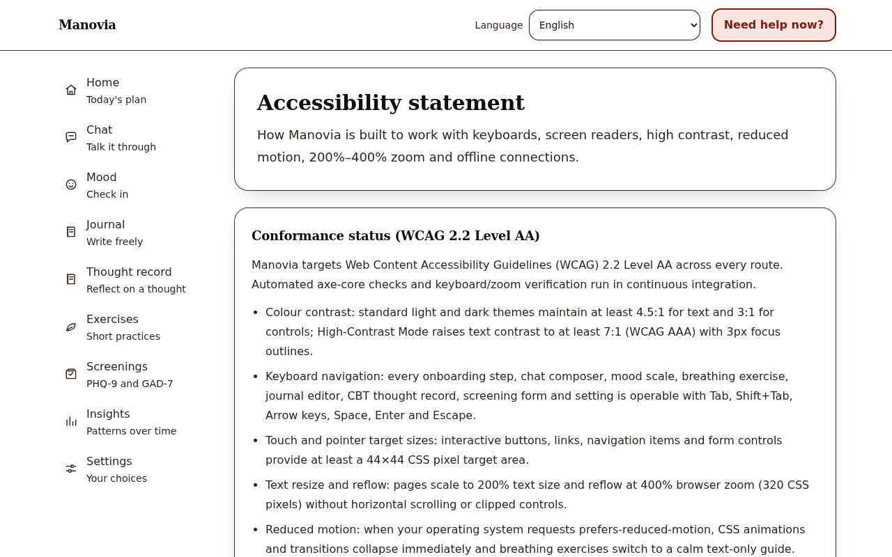
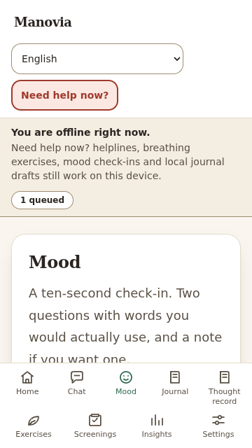
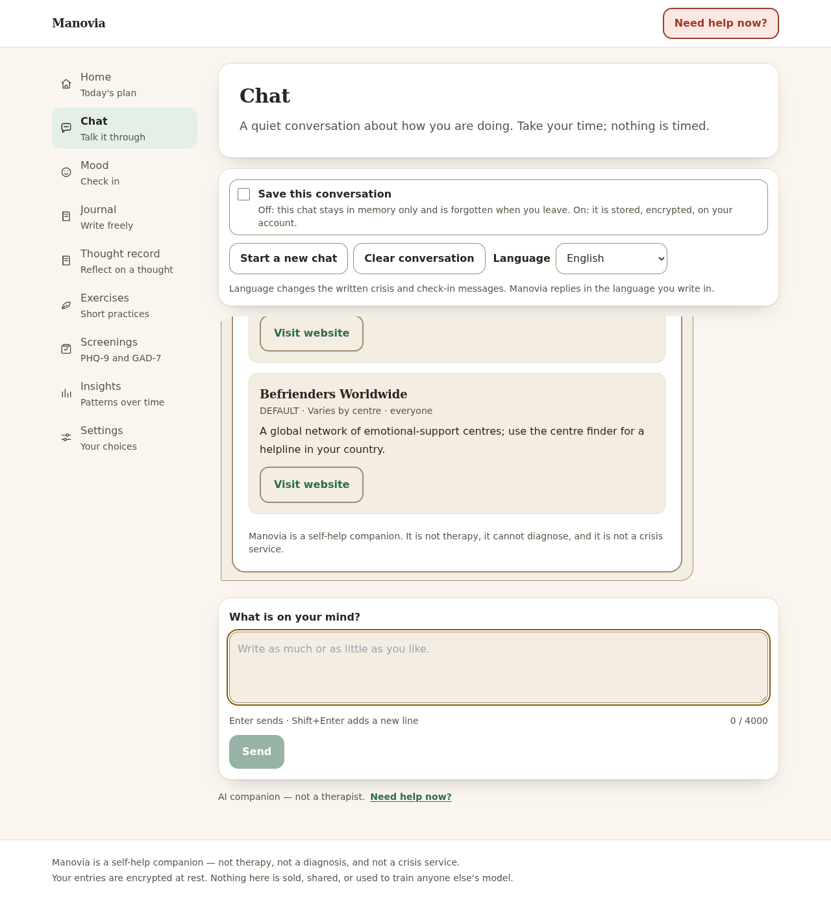

# Manovia

A privacy-first, safety-first mental wellbeing self-help companion—not therapy or diagnosis.

> **Important:** Manovia is not a substitute for professional care. If you are in crisis, call your local emergency number now.

[](https://github.com/BuildbyArindam/Manovia/actions/workflows/ci.yml)


## Features

- **Supportive chat** — a safety-first chat surface. Deterministic crisis rules run *before* any model call; high-risk messages get a pre-written support reply and helpline resources, never a generation. Everything else flows through PII redaction, curated retrieval, a provider chain (Anthropic / Ollama / canned local fallback), and a whole-reply output guard before anything is persisted or shown ([ADR 0011](docs/adr/0011-chat-orchestrator.md)).
- **Safety evaluation** — rules-first + ML crisis detection with an ensemble, an offline eval set, and `evals/run_safety_eval.py` scoring the pipeline against labelled prompts.
- **Mood check-ins** — 5-face valence and energy scales, emotion and factor tags, timezone-correct history and streaks, encrypted notes ([ADR 0015](docs/adr/0015-mood-check-ins.md)).
- **Encrypted journal** — AES-256-GCM envelope-encrypted entries with per-entry keys ([ADR 0017](docs/adr/0017-encrypted-journal-and-envelope-encryption.md)).
- **Guided exercises** — eight validated, audio-free exercises with a keyboard-operable local runner, pause/resume, and reduced-motion support ([ADR 0018](docs/adr/0018-guided-exercises.md)).
- **CBT thought record** — a seven-step, owner-only encrypted wizard with per-step safety screening and a closed-set thinking-trap helper ([ADR 0019](docs/adr/0019-cbt-thought-record.md)).
- **PHQ-9 & GAD-7 screenings** — the official instrument wording and published scoring, with support options shown before any score when PHQ-9 item 9 is positive ([ADR 0020](docs/adr/0020-phq-9-and-gad-7-screenings.md)).
- **Daily plan** — a transparent, rule-based planner that suggests at most three things a day, each with a "why this?" explanation, honours quiet hours, and reduces to support-only after a positive item 9 ([ADR 0021](docs/adr/0021-daily-plan-and-week-3-review.md)).
- **Offline-first PWA, WCAG 2.2 AA accessibility & low-bandwidth delivery** — installable Web App Manifest with original procedural icons, a Workbox `injectManifest` Service Worker that caches the app shell, verified crisis helplines and guided breathing exercises for offline use, an offline mood check-in queue that syncs automatically on reconnect, local-only journal draft persistence, High-Contrast Mode (`>= 7:1` WCAG AAA contrast), 200%–400% zoom reflow, an in-app [Accessibility statement](frontend/src/pages/AccessibilityPage.tsx), route-level code splitting, and automated axe + Lighthouse CI gates ([ADR 0025](docs/adr/0025-pwa-accessibility-low-bandwidth.md)).
- **Foundations** — guest auth with consent gating, structured logging with log redaction, security headers, field-level encryption, and a React frontend with design tokens, two navigations, an onboarding gate, and a crisis helpline dialog.

## Screenshots

| Surface | Preview |
| --- | --- |
| **Accessibility statement in High-Contrast Mode (Desktop `1280×800`)** |  |
| **Offline banner & queued mood check-in (Mobile `360×640`)** |  |
| **Supportive chat with deterministic crisis card (Desktop `1280×800`)** |  |

Manovia is a self-help companion, not therapy or diagnosis. See [docs/architecture.md](docs/architecture.md) for how a message travels, and [docs/model-card.md](docs/model-card.md) for the safety model's intended use and limits.

## Architecture

Manovia is a monorepo: a FastAPI backend, a React + Vite + TypeScript frontend, PostgreSQL persistence (SQLite for local work), and provider-abstracted language-model integrations. See [ADR 0001](docs/adr/0001-monorepo-and-stack.md), [ADR 0002](docs/adr/0002-backend-skeleton-conventions.md) and [ADR 0005](docs/adr/0005-frontend-skeleton.md).

## Quick start

### With Docker (the easy way)

Docker Desktop (or Docker Engine + the compose plugin) is the only prerequisite:

```bash
cp .env.example .env     # optional: the stack runs on dev-only defaults without it
make up                  # build and start api + web + postgres in the background
make smoke               # end-to-end smoke test: readiness, guest, consent, web 200
docker compose logs -f   # follow the logs (Ctrl-C to detach)
make down                # stop the stack (wipe the DB with: docker compose down -v)
```

Once `make up` reports the services started: web on <http://localhost:3000>,
API on <http://localhost:8000> (interactive docs at `/docs`). In development
the API container runs `alembic upgrade head` on every start, so a fresh stack
lands on a migrated database (see `backend/docker-entrypoint.sh`; it never
auto-migrates outside `APP_ENV=development`).

### Without Docker (local toolchain)

Python 3.11+ and Node 20.19+:

```bash
# Backend — API on http://localhost:8000 (interactive docs at /docs)
cd backend
pip install -e ".[dev]"   # or: uv sync
alembic upgrade head      # create the schema
make dev

# Frontend — http://localhost:5173, with /api proxied to the backend
cd ../frontend
npm ci
npm run dev
```

| Command                       | What it does                                        |
| ----------------------------- | --------------------------------------------------- |
| `make up`                     | Build and start the Docker dev stack                |
| `make down`                   | Stop the Docker dev stack (keeps the DB volume)     |
| `make smoke`                  | Run `scripts/smoke.sh` against the stack            |
| `make dev`                    | Backend API on :8000                                |
| `make frontend-dev`           | Frontend dev server on :5173 (proxies `/api`)       |
| `make test`                   | Backend pytest + frontend Vitest                    |
| `make lint`                   | Backend ruff + mypy, frontend ESLint                |
| `make format`                 | Backend ruff format, frontend Prettier              |
| `make db-upgrade`             | `alembic upgrade head`                              |
| `make seed`                   | Create the demo user and its rows                   |
| `make eval`                   | Run the Day 9 safety evaluation (`evals/run_safety_eval.py`) |

The frontend's own commands live in [frontend/README.md](frontend/README.md).

## Safety

Manovia is a self-help companion, not therapy, a diagnostic tool, or a crisis service. Crisis/self-harm detection must run before any LLM call; high-risk messages must receive deterministic, pre-written support. Every LLM response must pass an output-safety check. See [AGENTS.md](AGENTS.md) for the non-negotiable safety rules.

## Privacy

Configuration comes only from environment variables (see `.env.example`); secrets are never committed. Message text, journal entries and mood notes are encrypted at rest (Fernet, per-field) and the structured logger recursively drops raw user text (`message_text`, `content`, `body`, `note`, credentials) — verified by an end-to-end log-redaction test. Identifiers are never sent to LLM providers.

## Roadmap

- **Week 1** — repository scaffolding, backend skeleton, data layer, auth with consent, frontend skeleton, NLP service, CI and Docker stack.
- **Week 2** — crisis rules before any model call, the safety ML classifier and first eval set, the LLM provider layer with PII redaction, the chat orchestrator and chat UI, knowledge base and retrieval, output guard and encrypted conversation memory.
- **Week 3** — mood check-ins, encrypted journal, guided exercises, the CBT thought record, PHQ-9/GAD-7 screenings, and the daily plan with a Week-3 review.
- **Next** — deployment workflows, clinician and native-speaker review of crisis content and safe replies (Hindi/Bengali first), and continued hardening of the safety surfaces.
