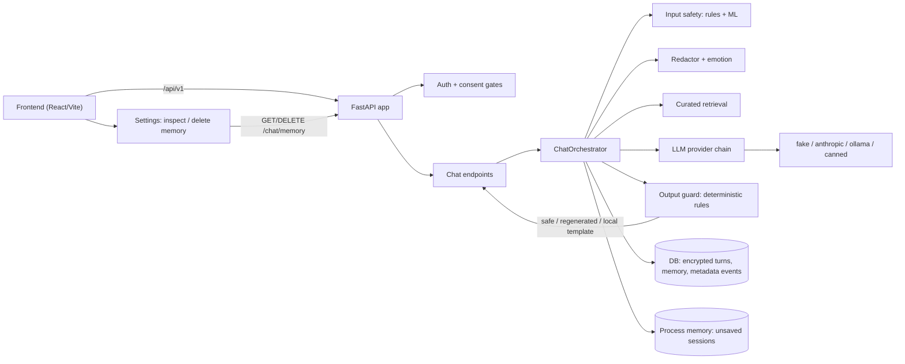
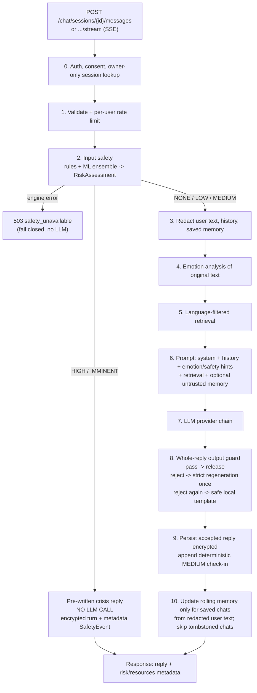
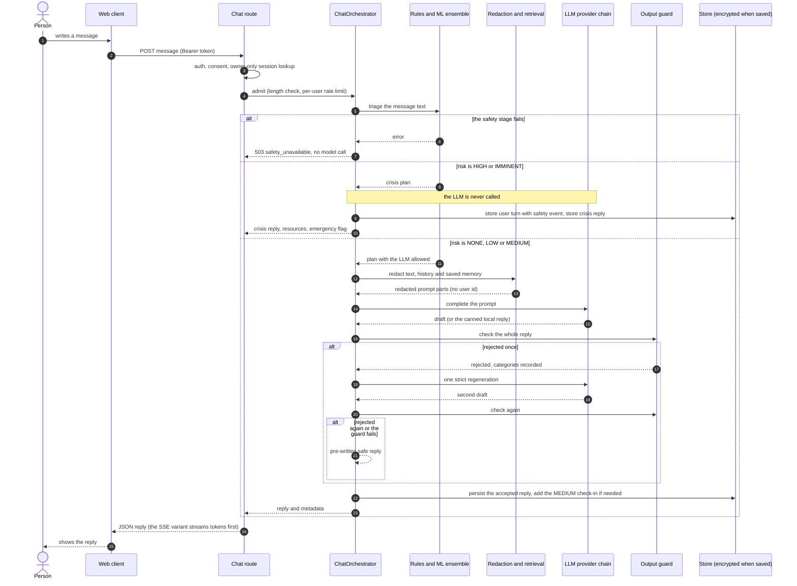
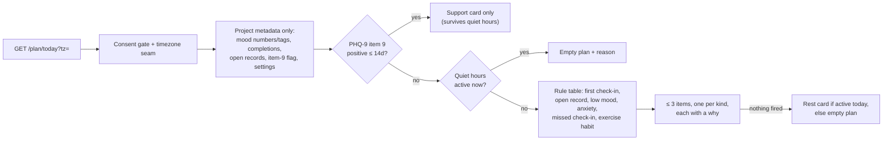
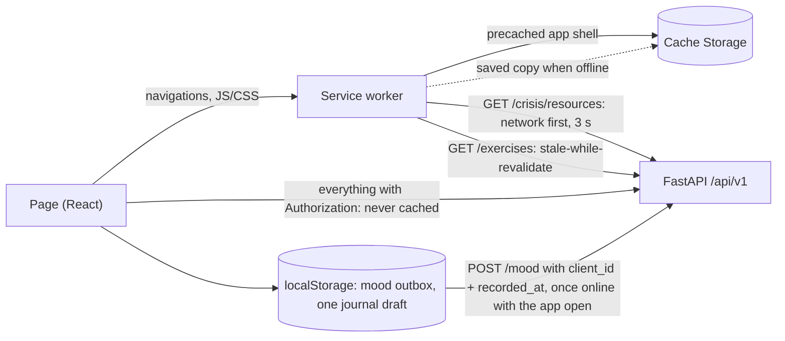

# Architecture

How a message travels through Manovia. Decisions and their reasons live in the
[ADRs](adr/); this page is the map. The chat orchestrator is described in
[ADR 0011](adr/0011-chat-orchestrator.md); Day 14 fills the output-safety seam
and adds encrypted, user-controlled saved-chat memory in
[ADR 0014](adr/0014-output-guard-and-conversation-memory.md).

## System



## The chat pipeline

One user message, in this exact order. **The order is the safety property**:
nothing that can call a model runs before the crisis gate; user text, history and
memory are redacted before they enter a prompt; and no generated text is persisted
or sent before the output guard accepts it.



### What each step may and may not do

| # | Step | On failure | Notes |
| --- | --- | --- | --- |
| 1 | Validate, rate limit | 422 / 429 | Before safety work; no model call. |
| 2 | Input safety | **503, no LLM** | HIGH/IMMINENT ends the pipeline. MEDIUM continues with a gentle hint/check-in. |
| 3 | Redaction | No model call; safe fallback | Applies to current text, stored history and stored summary memory. |
| 4 | Emotion | `emotion = None` | Reads the original text; it does not decide risk. |
| 5 | Retrieval | No reference passages | Curated and filtered by the supported language. |
| 6 | Prompt | n/a | The user id is never included. Memory is JSON-escaped and explicitly untrusted. |
| 7 | LLM | Local fallback | Provider chain ends at the canned local response. |
| 8 | Output guard | Local safe reply | YAML-backed deterministic categories; one stricter regeneration; streams buffer whole text. Rejections log/store category codes only. |
| 9 | Persist | Reply still returned | Assistant text is encrypted at rest; `persisted=false` if storage fails. |
| 10 | Memory update | Skip memory | Only if saved and `store_chat` is active; extractive, redacted user snippets, about 300 tokens max. |

## Sequence diagrams

These two diagrams follow the code path by path. The first is an ordinary turn;
the second is the crisis turn, which is the one that has to be right. Both read
from the same orchestrator (`backend/app/services/chat/orchestrator.py`).

### A chat turn (JSON endpoint)



### A crisis turn, including the "Need help now" path

```mermaid
sequenceDiagram
    autonumber
    actor P as Person
    participant UI as Web client (CrisisCard)
    participant SW as Service worker
    participant API as FastAPI
    participant O as ChatOrchestrator
    participant S as Rules and ML ensemble
    participant H as helplines.json (validated at load)
    participant DB as Store

    P->>UI: writes something that signals risk
    UI->>API: POST message
    API->>O: respond
    O->>S: rules first; the ML model may raise the level, never lower it
    S-->>O: HIGH or IMMINENT, with evidence codes only
    O->>O: choose the localised template for the language (no LLM)
    O->>H: resources for the region, emergency number first
    H-->>O: numbers, hours, instructions, source dates
    O->>DB: store the user turn and a metadata safety event
    alt storing fails
        O->>O: log the error type only, still reply
    end
    O-->>API: reply, risk level, resources, emergency flag, persisted flag
    API-->>UI: JSON
    UI-->>P: CrisisCard with call links and the emergency instruction

    Note over P,UI: Later, the person may be offline
    P->>UI: taps Need help now
    UI->>SW: GET /api/v1/crisis/resources
    alt the network answers within 3 seconds
        SW->>API: fetch the resources
        API-->>SW: current resources
        SW-->>UI: resources
    else offline or slow
        SW-->>UI: the copy saved on this device at the last online visit (none yet: the dialog says so)
        UI-->>P: dialog with an offline note
    end
```

Two properties hold in both diagrams. The model is never called at HIGH or
IMMINENT. The reply does not wait for storage: if the database write fails, the
person still gets the crisis reply, with `persisted=false`. The offline copy is a
snapshot: the dialog says these are the helplines saved on this device the last time
it was online.

## Where a conversation lives

| | Ephemeral (default) | Saved (`save_history = true`) |
| --- | --- | --- |
| Needs consent | `ai_disclosure`, `terms` | + `store_chat` |
| Turns stored in | Process memory, sliding TTL | `chat_sessions` + `messages` (Fernet-encrypted text) |
| Rolling memory | Never created or sent | `chat_sessions.memory_encrypted` (Fernet ciphertext, redacted snippets) |
| After idle / restart | Gone | Kept until deleted with the chat/account lifecycle |
| Output-safety event | Anonymous metadata row | Linked to the saved session while storage consent is active |

`GET /api/v1/chat/memory` returns summaries to the authenticated owner. The Settings
panel displays them. `DELETE /api/v1/chat/memory` clears summaries and tombstones
existing sessions so later turns cannot rebuild what was deleted; it does not
remove the encrypted chat transcript.

## The daily plan

Day 21's planner ([ADR 0021](adr/0021-daily-plan-and-week-3-review.md)) answers
"what, if anything, should we suggest today?" with **no model**: a table of named
rules in `app/services/plan/daily_plan.py`, each a pure function from a
`PlannerContext` to an optional suggestion, evaluated in priority order.



Hard limits, enforced by construction: at most three suggestions; every
suggestion carries a non-empty "why" (the dataclass rejects construction
without one); rules fire on multi-day signals only; an empty plan is a valid
answer. `plan_items` is unique per user+local-day+kind, so `GET /plan/today`
is idempotent and `POST /plan/{id}/done|skip` settle items without requiring a
reason.

The privacy contract is the same one the rest of the app keeps: the API layer
projects closed-vocabulary columns (local dates, valence, emotion tags,
completion ids, whether a thought record has a "what helped" step) into the
context; encrypted free text is never decrypted for planning. Preferences —
preferred exercise tags and quiet hours, stored in `user_settings` with strict
`HH:MM` bounds — are the only settings the planner reads, managed at
`GET/PUT /settings`.

## Offline: what the service worker may answer (Day 25)

The production build registers a service worker (`frontend/src/sw/sw.ts`); the
dev server never does. It sits between the page and `/api/v1` and is allowed to
answer from Cache Storage for exactly three things. Everything else goes to the
network as before. The full reasoning is in
[ADR 0025](adr/0025-pwa-accessibility-low-bandwidth.md).



The worker never sees the session token and has no background sync. Offline
check-ins are sent by the page (`features/mood/OutboxSync.tsx`); the server
deduplicates them by `(user_id, client_id)` and screens every note, including a
replay, before storing it.

## Response contract

JSON: `{reply, session_id, message_id, metadata}`.
SSE: zero or more checked `event: token` (`{"text"}`), then one `event: final` with
the same fields plus `replaced`; `final.reply` is authoritative. The production
output guard buffers the complete model response, so no unchecked text reaches a
token event. A fallback is sent as checked template tokens.

`metadata.response_type` precedence: `crisis` > `fallback` > `check_in` >
`normal`. `metadata.crisis` carries what the frontend `CrisisCard` needs
(message, helplines, emergency instruction). Helpline data comes only from
`backend/app/content/helplines.json`.

## Known limits

Output patterns and check-in phrases are deterministic starter coverage, not a
proof that every unsafe paraphrase is caught. Native-script output patterns and
safe-template translations need a clinician and native-speaker review. The local
memory is intentionally extractive rather than a polished LLM summary, and the
300-token estimate is conservative UTF-8 bytes/4 rather than provider-tokenizer
exact.
