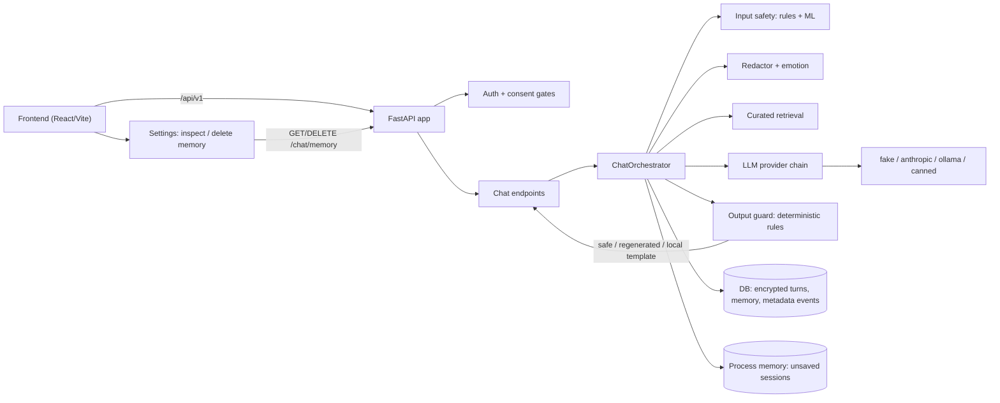
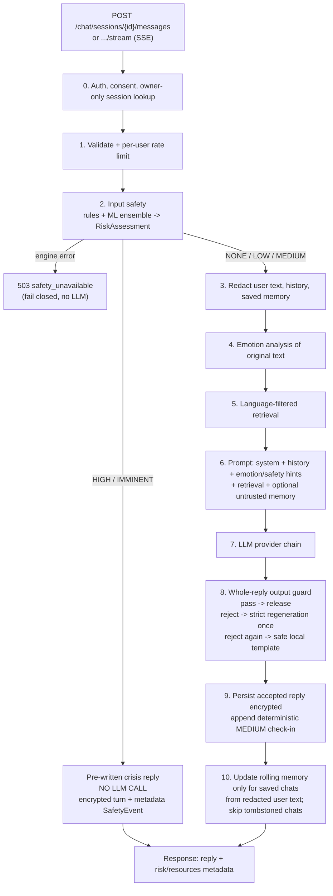

# Architecture

How a message travels through Manovia. Decisions and their reasons live in the
[ADRs](adr/); this page is the map. The chat orchestrator is described in
[ADR 0011](adr/0011-chat-orchestrator.md); Day 14 fills the output-safety seam
and adds encrypted, user-controlled saved-chat memory in
[ADR 0014](adr/0014-output-guard-and-conversation-memory.md).

## System

## The chat pipeline

One user message, in this exact order. **The order is the safety property**:
nothing that can call a model runs before the crisis gate; user text, history and
memory are redacted before they enter a prompt; and no generated text is persisted
or sent before the output guard accepts it.

### What each step may and may not do

| # | Step | On failure | Notes |
| --- | --- | --- | --- |
| 1 | Validate, rate limit | 422 / 429 | Before safety work; no model call. |
| 2 | Input safety | **503, no LLM** | HIGH/IMMINENT ends the pipeline. MEDIUM continues with a gentle hint/check-in. |
| 3 | Redaction | No model call; safe fallback | Applies to current text, stored history and stored summary memory. |
| 4 | Emotion | `emotion = None` | Reads the original text; it does not decide risk. |
| 5 | Retrieval | No reference passages | Curated and filtered by the supported language. |
| 6 | Prompt | n/a | The user id is never included. Memory is JSON-escaped and explicitly untrusted. |
| 7 | LLM | Local fallback | Provider chain ends at the canned local response. |
| 8 | Output guard | Local safe reply | YAML-backed deterministic categories; one stricter regeneration; streams buffer whole text. Rejections log/store category codes only. |
| 9 | Persist | Reply still returned | Assistant text is encrypted at rest; `persisted=false` if storage fails. |
| 10 | Memory update | Skip memory | Only if saved and `store_chat` is active; extractive, redacted user snippets, about 300 tokens max. |

## Where a conversation lives

| | Ephemeral (default) | Saved (`save_history = true`) |
| --- | --- | --- |
| Needs consent | `ai_disclosure`, `terms` | + `store_chat` |
| Turns stored in | Process memory, sliding TTL | `chat_sessions` + `messages` (Fernet-encrypted text) |
| Rolling memory | Never created or sent | `chat_sessions.memory_encrypted` (Fernet ciphertext, redacted snippets) |
| After idle / restart | Gone | Kept until deleted with the chat/account lifecycle |
| Output-safety event | Anonymous metadata row | Linked to the saved session while storage consent is active |

`GET /api/v1/chat/memory` returns summaries to the authenticated owner. The Settings
panel displays them. `DELETE /api/v1/chat/memory` clears summaries and tombstones
existing sessions so later turns cannot rebuild what was deleted; it does not
remove the encrypted chat transcript.

## Response contract

JSON: `{reply, session_id, message_id, metadata}`.
SSE: zero or more checked `event: token` (`{"text"}`), then one `event: final` with
the same fields plus `replaced`; `final.reply` is authoritative. The production
output guard buffers the complete model response, so no unchecked text reaches a
token event. A fallback is sent as checked template tokens.

`metadata.response_type` precedence: `crisis` > `fallback` > `check_in` >
`normal`. `metadata.crisis` carries what the frontend `CrisisCard` needs
(message, helplines, emergency instruction). Helpline data comes only from
`backend/app/content/helplines.json`.

## Known limits

Output patterns and check-in phrases are deterministic starter coverage, not a
proof that every unsafe paraphrase is caught. Native-script output patterns and
safe-template translations need a clinician and native-speaker review. The local
memory is intentionally extractive rather than a polished LLM summary, and the
300-token estimate is conservative UTF-8 bytes/4 rather than provider-tokenizer
exact.
