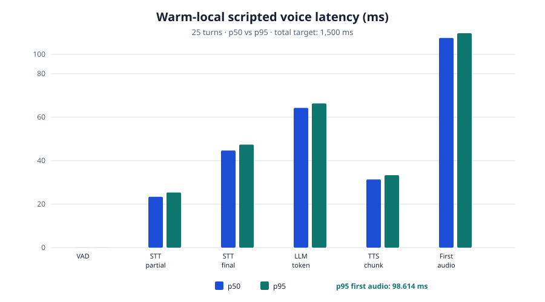

# Verification — Day 40 real-time voice companion

**Date:** 2026-10-16
**Scope:** authenticated PCM WebSocket streaming, WebRTC VAD, incremental STT →
existing chat orchestration → sentence TTS, local barge-in, crisis safety and
browser controls. This record distinguishes executed sandbox evidence from the
manual-device checks that the sandbox cannot perform.

## Architecture and safety invariants

1. The browser opens a **same-origin** `wss://…/api/v1/voice/sessions/{id}/stream`
   connection. It offers `manovia.v1` and `bearer.<access token>` as WebSocket
   subprotocols; the access token, PCM and transcript never appear in a URL.
2. The server accepts only `manovia.v1` after validating the access token,
   refresh family, current user, consent and ownership of the existing chat
   session. It rejects missing or URL-only credentials with `4401`, malformed
   session IDs with `4400`, and a different user's session with `4404`.
3. WebRTC VAD sees transient 10 ms PCM16 frames only and yields a boolean
   speech/silence boundary. It has no emotion, mood, health, identity or speaker
   output. Only **STT transcript words** reach `ChatOrchestrator.admit()` and
   `ChatOrchestrator.stream()`.
4. Browser playback stops synchronously on the first locally detected speech
   frame; the matching PCM packet triggers server cancellation as a second
   layer. The target is under 300 ms, not a round-trip-dependent UI update.
5. High/imminent crisis transcript routes through the existing deterministic
   crisis branch. It emits localised, reviewed, in-memory cached crisis WAV and
   visible helplines/continue/end controls. It does not call the LLM or emit a
   generic pre-crisis TTS chunk.
6. PCM, recognition state, rendered live transcript, playback queue and latency
   state stay in RAM for the open session. The feature adds no audio/transcript
   database storage, temporary audio file, browser local storage, IndexedDB or
   upload route. The existing chat-history choice is the only transcript
   persistence choice. A HIGH/IMMINENT ephemeral turn retains the pre-existing
   anonymous, text-free safety-event audit (no user/session id, PCM or words).

The implementation decision and trade-offs are in
[ADR 0039](../adr/0039-realtime-voice-companion.md).

## Scripted latency simulation — executed

Command run from the repository root:

```console
$ make voice-sim
Voice simulation: 25 warm local scripted turns (all timings in ms)
stage                              p50       p95
------------------------------------------------
vad_ms                           0.012     0.016
stt_first_partial_ms            23.383    25.376
stt_final_ms                    44.661    47.385
llm_first_token_ms              64.285    66.322
tts_first_chunk_ms              31.344    33.323
time_to_first_audio_ms          96.443    98.614

PASS: p95 time-to-first-audio 98.614 ms < 1500 ms target
```

The simulation has fixed, short fake stages and contains no recording, voice
sample or transcript. It measures the real `LatencyBreakdown`/percentile logic,
not microphone hardware or a remote provider. It is a warm-local target check,
not a production SLO claim.



| stage | p50 (ms) | p95 (ms) |
| --- | ---: | ---: |
| WebRTC VAD | 0.012 | 0.016 |
| STT first partial | 23.383 | 25.376 |
| STT final | 44.661 | 47.385 |
| LLM first token | 64.285 | 66.322 |
| TTS first chunk | 31.344 | 33.323 |
| **time to first audio** | **96.443** | **98.614** |

## Barge-in simulation — executed

The scripted `RealtimeVoiceSession` barge-in fixture was run with a deliberately
slow first-token fake (1,000 ms) so cancellation, rather than normal completion,
was measured. The second voiced PCM packet runs the same code covered by
`test_barge_in_cancels_pending_assistant_audio_inside_target`:

```console
BARGE-IN simulated elapsed: 0.165 ms
BARGE-IN server acknowledgement: 0.009 ms
BARGE-IN target: 300 ms
```

Both values are below the configured target. This measures server cancellation;
the browser unit test independently proves the local `AudioBufferSourceNode`
stop is synchronous on the first signal frame, without waiting for this packet's
round trip.

## Automated scripted coverage — executed

The focused Day 40 backend command was run after replacing the temporary energy
gate with WebRTC VAD:

```console
$ cd backend && ../.venv/bin/pytest -q tests/unit/test_config.py \
    tests/voice/test_realtime.py tests/integration/test_realtime_voice_ws.py \
    tests/integration/test_realtime_voice_ws_security.py
94 passed, 1 warning
```

The warning is FastAPI/Starlette's current TestClient deprecation notice; no
Day 40 assertion failed. Backend `ruff check`, `ruff format` and `mypy app
tests` also passed after that command (342 typed source files).

Coverage includes:

| scenario | scripted assertion |
| --- | --- |
| timing | per-stage p50/p95 and p95 first-audio budget |
| streaming | partial/final STT, sentence-level assistant audio, shared orchestrator stream |
| barge-in | cancellation acknowledgement measured under the 300 ms configured target; no later audio chunk |
| high risk | cached localised crisis audio/resources, no generic assistant audio, LLM call count and stream count both zero |
| STT failure | a spoken, visible type-instead fallback |
| LLM timeout | orchestrator fallback plus synthesized spoken reply/type option |
| WebSocket auth | selected public subprotocol only; missing/URL-only credential, malformed ID and cross-user session rejection |
| default storage | actual SQLite inspection after a high-risk ephemeral voice turn: 0 `chat_sessions`, 0 `messages`; no new temp file/logged transcript; exactly one anonymous, text-free safety-event row |
| browser protocol | same-origin URL, PCM conversion/parser validation, synchronous queued-audio stop, microphone retry and network type fallback |

Frontend targeted Vitest executed before the WebRTC backend change:

```console
$ cd frontend && npm run lint && npm run typecheck && \
    npm run test:run -- src/lib/api.test.ts src/features/chat/realtime.test.ts \
    src/features/chat/audioPlayback.test.ts src/features/chat/VoiceCompanion.test.tsx
4 files passed, 26 tests passed
```

It includes a fake socket/recorder/player: PCM forwarding, local barge-in stop,
crisis card + helpline + continue event, muted playback, denied-microphone
cleanup/retry, and an `error` without a matching `close` event. The last case
injects assistant audio first, then a socket error, and asserts that playback is
stopped before the visible type fallback — a simulated **mid-response** network
drop.

## Full regression verification — executed

The first full backend run exposed stale generated API documentation after the
Day 40 compatibility-route descriptions changed. This was root-fixed by running
`cd backend && ../.venv/bin/python scripts/export_openapi.py`; the generated
`docs/openapi.json` and `docs/api.md` are committed. No test or gate was
weakened. The re-run then passed:

```console
$ PATH="$PWD/.venv/bin:$PATH" make -C backend test
4651 passed, 4 skipped, 50 warnings
coverage gate: all rules satisfied
# overall coverage: 94.13% statements / 86.11% branches
```

`PATH` names this sandbox's project virtual environment; in a normally activated
backend virtual environment, plain `make -C backend test` is equivalent. Root
`make lint` was also rerun with that virtual environment and passed: Ruff,
formatting, mypy (342 source files) and frontend ESLint.

```console
$ cd frontend && npm run test:run && npm run build
77 files passed, 1 skipped; 624 tests passed, 3 skipped
vite production build: PASS
```

The full Vitest run emits existing React `act(...)`, jsdom `scrollTo`, and React
Router future-flag warnings but exits zero. `npm run format:check` still reports
four files outside Day 40 (`e2e/day25/keyboard.spec.ts`,
`src/features/chat/Composer.tsx`, `src/features/chat/VoiceRecorder.tsx`, and
`src/scripts/playwrightFailures.test.ts`); every Day 40 changed frontend path
passes Prettier. The sandbox has no downloaded Playwright browser, so the updated
voice Playwright specification is source/type checked but must run in the
manual-device/browser environment below.

## No-acoustic-inference source audit — executed

```console
$ grep -RniE 'emotion[_ -]?(score|classif|infer)|health[_ -]?(score|classif|infer)|speaker[_ -]?(embedding|identif)|voice[_ -]?(emotion|health)|prosody|pitch[[:space:]_-]*(feature|analys)' \
    backend/app/services/voice frontend/src/features/chat --exclude='*.test.*'
PASS: no voice-feature emotion/health/identity inference implementation terms found.
```

A companion storage-token scan finds only the explicit frontend comment that
forbids `localStorage`, `IndexedDB` and upload use; the actual default-storage
regression is the SQLite/temp/log inspection in the coverage table above.

## Failure behaviour

| failure | spoken behaviour | visible typed fallback |
| --- | --- | --- |
| network drop | browser `SpeechSynthesis` speaks a reviewed “connection dropped” apology when available; duplicate `error`/`close` signals are gated | yes |
| STT failure | server synthesizes a reviewed “could not understand” apology | yes |
| LLM timeout/degraded response | the same existing orchestrator fallback is synthesized sentence-by-sentence | yes |
| local TTS failure | transcript remains visible and a type-or-keep-talking notice is shown | yes |
| silence timeout | server closes the live session after the configured timeout and displays a pause/type message | yes |
| microphone denied/unavailable | browser closes/release the pending socket/media and speaks a local apology when available | yes |

## Manual-device checklist (required before release)

The sandbox cannot grant microphone access, route Bluetooth audio, verify Web
Audio playback, run a downloaded Playwright browser, or fetch STT/Piper model
artifacts. On a real HTTPS same-origin deployment, perform and record:

1. **Permissions and controls:** with Chrome/Firefox/Safari on a desktop and an
   Android/iOS device, grant and deny microphone permission. Verify prominent
   Stop releases the indicator/track, mute stops audio but continues listening,
   transcript Hide/Show works, and reload/end removes the in-session transcript.
2. **Turn latency and barge-in:** make at least 30 short warm-local turns with
   the production local models; capture the six client/server timing fields,
   report p50/p95, and interrupt every assistant response. Record audible stop
   latency; it must remain below 300 ms under normal local load.
3. **Crisis:** speak/test a reviewed HIGH-risk fixture in each supported locale.
   Verify audible cached local crisis copy starts first, the local helplines are
   visible/clickable, continue/end are usable, and the LLM trace/counter is zero.
4. **Failure recovery:** disconnect network mid-response, force STT error and
   force LLM timeout. Hear one apology per failure, see type fallback, and
   confirm a fresh Start works after a denied microphone/network recovery.
5. **Privacy:** inspect browser storage, DevTools Network/WS frames, API logs,
   temporary directories and the database before/after a non-persistent session.
   Confirm no raw PCM or live transcript is stored/logged and that the token is
   not in the WebSocket URL. If chat history is explicitly enabled, verify only
   the existing chosen text-history semantics apply.
6. **Accessibility/audio routing:** keyboard-only test Start/Stop/mute/transcript
   and crisis choices; run a screen reader; test Bluetooth/headset device changes
   and system-volume/mute behaviour. Confirm the visible transcript carries the
   same content as spoken assistant audio.

## Known boundaries

- Fake STT/TTS keeps the automated suite offline and deterministic; real local
  model accuracy, native-language voice quality and hardware latency are not
  measured here.
- The browser native spoken fallback depends on `SpeechSynthesis`; the on-screen
  message and text composer remain available where that API is absent.
- WebRTC VAD is a speech boundary tool, not an emotion/health detector. It must
  not be extended with acoustic trait inference without a new reviewed decision.
- The Day 39 upload endpoint remains a compatibility route. Day 40 live PCM
  uses only the authenticated WebSocket path above.
