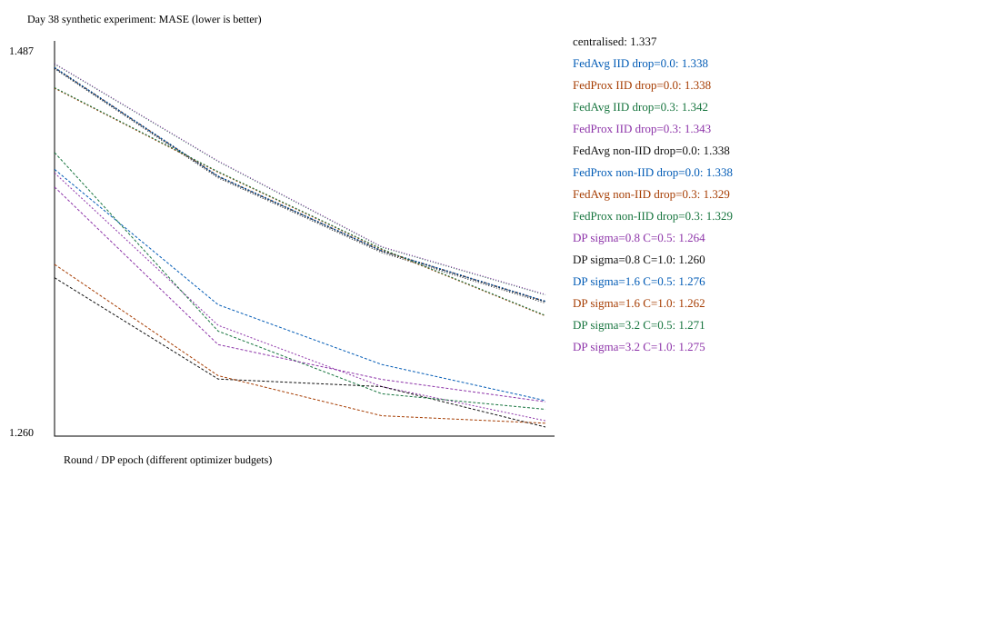

# Day 38 — synthetic smoke evidence (not real-user training)

MLflow run: `aba1806ad18e48a8959065639f04e14d`. Seed: `38`. Clients: 50.
Data SHA256: `78a729e3f329137481e1c6436260411f33a12c9af70d92db5b8b875a8f9cd5cc`; train/test pairs: 655/253.
Client mean-target SD (normalised): 0.2288.
Persistence held-out MASE: 1.1150; training persistence denominator (normalised mood): 0.2588.

| Model | MASE ↓ | attack AUC | epsilon | delta | optimizer steps |
| --- | ---: | ---: | ---: | ---: | ---: |
| centralised | 1.3372 | 0.5518 | not DP | — | 8 |
| FedAvg IID drop=0.0 | 1.3380 | 0.5519 | not DP | — | local, see config |
| FedProx IID drop=0.0 | 1.3384 | 0.5518 | not DP | — | local, see config |
| FedAvg IID drop=0.3 | 1.3423 | 0.5527 | not DP | — | local, see config |
| FedProx IID drop=0.3 | 1.3427 | 0.5528 | not DP | — | local, see config |
| FedAvg non-IID drop=0.0 | 1.3381 | 0.5521 | not DP | — | local, see config |
| FedProx non-IID drop=0.0 | 1.3384 | 0.5520 | not DP | — | local, see config |
| FedAvg non-IID drop=0.3 | 1.3291 | 0.5516 | not DP | — | local, see config |
| FedProx non-IID drop=0.3 | 1.3295 | 0.5516 | not DP | — | local, see config |
| DP sigma=0.8 C=0.5 | 1.2635 | 0.5470 | 8.1267 | 1e-05 | 44 |
| DP sigma=0.8 C=1.0 | 1.2596 | 0.5484 | 8.1267 | 1e-05 | 44 |
| DP sigma=1.6 C=0.5 | 1.2761 | 0.5469 | 2.2014 | 1e-05 | 44 |
| DP sigma=1.6 C=1.0 | 1.2620 | 0.5477 | 2.2014 | 1e-05 | 44 |
| DP sigma=3.2 C=0.5 | 1.2707 | 0.5484 | 0.8417 | 1e-05 | 44 |
| DP sigma=3.2 C=1.0 | 1.2754 | 0.5459 | 0.8417 | 1e-05 | 44 |

## Operating point (research only)

Predeclared research operating point: **DP sigma=3.2 C=1.0**, epsilon 0.8417 at delta 1e-05. Highest configured noise reduces epsilon; C=1 allows more signal than C=0.5. No holdout-based selection, no deployment recommendation. MASE difference from central MASE: -0.0618.
Attack AUC: non-private 0.5518, chosen DP 0.5459. Distance to chance changes from 0.0518 to 0.0459.

If all 6 DP models were released on real private data, with independent secret randomness, basic composition gives epsilon ≤ 22.3396, delta ≤ 6e-05, before selection/metric releases.

## Limits and interpretation

- All inputs are MIT-authored synthetic Day-36 state-space data; catalogue entry: Manovia synthetic federated mood pairs (Day 38).
- A small next-day regression head, not the Day-36 GRU or a clinical model. MASE uses mean |next-day minus current-day| on training pairs. Fixed public normalisation. No categorical accuracy is applicable.
- Nonoverlapping pairs, random within-person holdout, same people at test; not unseen-user or prospective performance. One seed; no confidence claim.
- Flower FedAvg/FedProx aggregate_fit runs serially in-process; no Ray, device transport, secure aggregation, or DP federated updates. Dropout is independent per round, not adversarial or mid-upload.
- DP is central record-level add/remove-one-pair Opacus RDP, not user-level. Full-cohort central/FL and Poisson minibatch DP have different optimizer step counts. No fair compute/utility superiority claim.
- Seeded noncryptographic RNG, secure_mode=False: synthetic research only. Every DP sweep is a separate hypothetical release. Releasing all requires composition; test metrics and private-data selection also require accounting.
- Loss-score AUC may already be near chance, or move away from chance. A single tiny attack does NOT demonstrate a defence or prove privacy. Do not change attack direction or tune on holdout to manufacture success.

## Convergence and participation

Values below are held-out MASE after each round/DP epoch; not tuning input.
- centralised: 1.4839, 1.4156, 1.3688, 1.3372
- FedAvg IID drop=0.0: 1.4845, 1.4163, 1.3696, 1.3380
  Responding clients: [50, 50, 50, 50].
- FedProx IID drop=0.0: 1.4847, 1.4167, 1.3700, 1.3384
  Responding clients: [50, 50, 50, 50].
- FedAvg IID drop=0.3: 1.4869, 1.4258, 1.3722, 1.3423
  Responding clients: [34, 29, 33, 35].
- FedProx IID drop=0.3: 1.4872, 1.4262, 1.3726, 1.3427
  Responding clients: [34, 29, 33, 35].
- FedAvg non-IID drop=0.0: 1.4845, 1.4164, 1.3697, 1.3381
  Responding clients: [50, 50, 50, 50].
- FedProx non-IID drop=0.0: 1.4848, 1.4168, 1.3701, 1.3384
  Responding clients: [50, 50, 50, 50].
- FedAvg non-IID drop=0.3: 1.4718, 1.4191, 1.3708, 1.3291
  Responding clients: [34, 29, 33, 35].
- FedProx non-IID drop=0.3: 1.4721, 1.4195, 1.3711, 1.3295
  Responding clients: [34, 29, 33, 35].
- DP sigma=0.8 C=0.5: 1.4187, 1.3232, 1.2849, 1.2635
- DP sigma=0.8 C=1.0: 1.3531, 1.2896, 1.2849, 1.2596
- DP sigma=1.6 C=0.5: 1.4209, 1.3362, 1.2987, 1.2761
- DP sigma=1.6 C=1.0: 1.3614, 1.2918, 1.2667, 1.2620
- DP sigma=3.2 C=0.5: 1.4315, 1.3196, 1.2804, 1.2707
- DP sigma=3.2 C=1.0: 1.4099, 1.3112, 1.2894, 1.2754
